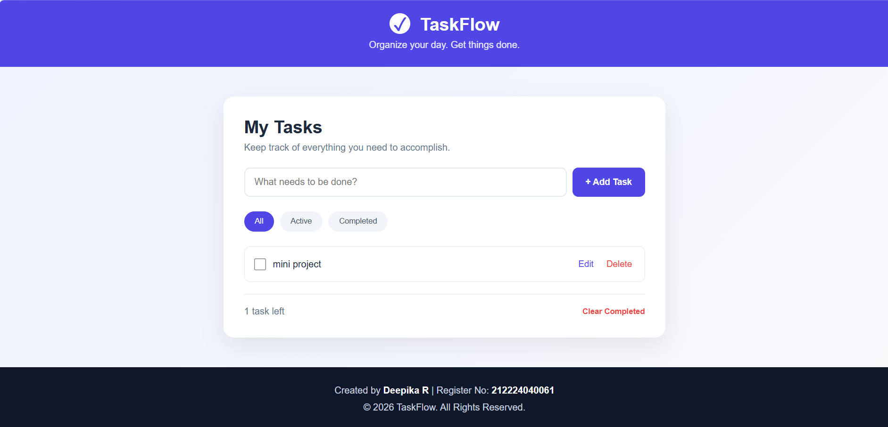

# Ex03 To-Do List using JavaScript
## Date:17.11.2026

## AIM
To create a To-do Application with all features using JavaScript.

## ALGORITHM
### STEP 1
Build the HTML structure (index.html).

### STEP 2
Style the App (style.css).

### STEP 3
Plan the features the To-Do App should have.

### STEP 4
Create a To-do application using Javascript.

### STEP 5
Add functionalities.

### STEP 6
Test the App.

### STEP 7
Open the HTML file in a browser to check layout and functionality.

### STEP 8
Fix styling issues and refine content placement.

### STEP 9
Deploy the website.

### STEP 10
Upload to GitHub Pages for free hosting.

## PROGRAM
HTML
```
<!DOCTYPE html>
<html lang="en">
<head>
    <meta charset="UTF-8">
    <meta name="viewport" content="width=device-width, initial-scale=1.0">

    <title>TaskFlow - Todo Application</title>

    <link rel="stylesheet" href="todo.css">
</head>

<body>

    <div class="app">

        <!-- Header -->
        <header>
            <div class="logo">
                <span>✓</span> TaskFlow
            </div>

            <p>Organize your day. Get things done.</p>
        </header>


        <!-- Main Container -->
        <main>

            <div class="todo-card">

                <h1>My Tasks</h1>

                <p class="subtitle">
                    Keep track of everything you need to accomplish.
                </p>


                <!-- Add Task -->
                <div class="input-area">

                    <input
                        type="text"
                        id="taskInput"
                        placeholder="What needs to be done?"
                    >

                    <button id="addBtn">
                        + Add Task
                    </button>

                </div>


                <!-- Filters -->
                <div class="filters">

                    <button class="filter active" data-filter="all">
                        All
                    </button>

                    <button class="filter" data-filter="active">
                        Active
                    </button>

                    <button class="filter" data-filter="completed">
                        Completed
                    </button>

                </div>


                <!-- Task List -->
                <ul id="taskList"></ul>


                <!-- Bottom Section -->
                <div class="bottom">

                    <span id="taskCount">
                        0 tasks left
                    </span>

                    <button id="clearCompleted">
                        Clear Completed
                    </button>

                </div>

            </div>

        </main>


        <!-- Footer -->
        <footer>

            <p>
                Created by <strong>Deepika R</strong>
                | Register No: <strong>212224040061</strong>
            </p>

            <p>
                © 2026 TaskFlow. All Rights Reserved.
            </p>

        </footer>

    </div>


    <script src="script.js"></script>

</body>
</html>
```
CSS
```
* {
    margin: 0;
    padding: 0;
    box-sizing: border-box;
}

body {
    font-family: Arial, Helvetica, sans-serif;
    background: linear-gradient(135deg, #eef2ff, #f8fafc);
    min-height: 100vh;
    color: #1e293b;
}

.app {
    min-height: 100vh;
    display: flex;
    flex-direction: column;
}


/* Header */

header {
    background: #4f46e5;
    color: white;
    padding: 28px 20px;
    text-align: center;
}

.logo {
    font-size: 30px;
    font-weight: bold;
}

.logo span {
    display: inline-flex;
    justify-content: center;
    align-items: center;
    width: 35px;
    height: 35px;
    background: white;
    color: #4f46e5;
    border-radius: 50%;
    margin-right: 8px;
}

header p {
    margin-top: 8px;
    opacity: 0.9;
}


/* Main */

main {
    flex: 1;
    display: flex;
    justify-content: center;
    padding: 50px 20px;
}

.todo-card {
    background: white;
    width: 100%;
    max-width: 750px;
    padding: 35px;
    border-radius: 18px;
    box-shadow: 0 15px 40px rgba(0, 0, 0, 0.08);
}

.todo-card h1 {
    font-size: 30px;
    margin-bottom: 8px;
}

.subtitle {
    color: #64748b;
    margin-bottom: 25px;
}


/* Input */

.input-area {
    display: flex;
    gap: 10px;
}

#taskInput {
    flex: 1;
    padding: 14px 16px;
    border: 2px solid #e2e8f0;
    border-radius: 10px;
    font-size: 16px;
    outline: none;
}

#taskInput:focus {
    border-color: #4f46e5;
}

#addBtn {
    background: #4f46e5;
    color: white;
    border: none;
    padding: 14px 22px;
    border-radius: 10px;
    cursor: pointer;
    font-size: 15px;
    font-weight: bold;
}

#addBtn:hover {
    background: #4338ca;
}


/* Filters */

.filters {
    display: flex;
    gap: 10px;
    margin: 25px 0;
}

.filter {
    border: none;
    background: #f1f5f9;
    color: #475569;
    padding: 9px 18px;
    border-radius: 20px;
    cursor: pointer;
}

.filter.active {
    background: #4f46e5;
    color: white;
}


/* Tasks */

#taskList {
    list-style: none;
}

.task {
    display: flex;
    align-items: center;
    gap: 12px;
    padding: 16px;
    border: 1px solid #e2e8f0;
    border-radius: 10px;
    margin-bottom: 10px;
    transition: 0.2s;
}

.task:hover {
    border-color: #c7d2fe;
    background: #fafaff;
}

.task-checkbox {
    width: 20px;
    height: 20px;
    cursor: pointer;
}

.task-text {
    flex: 1;
    font-size: 16px;
}

.task.completed .task-text {
    text-decoration: line-through;
    color: #94a3b8;
}


/* Buttons */

.task button {
    border: none;
    background: transparent;
    cursor: pointer;
    font-size: 15px;
    padding: 5px;
}

.edit-btn {
    color: #4f46e5;
}

.delete-btn {
    color: #ef4444;
}

.edit-btn:hover {
    color: #312e81;
}

.delete-btn:hover {
    color: #b91c1c;
}


/* Bottom */

.bottom {
    display: flex;
    justify-content: space-between;
    align-items: center;
    margin-top: 20px;
    padding-top: 20px;
    border-top: 1px solid #e2e8f0;
}

#taskCount {
    color: #64748b;
}

#clearCompleted {
    border: none;
    background: transparent;
    color: #ef4444;
    cursor: pointer;
    font-weight: bold;
}

#clearCompleted:hover {
    text-decoration: underline;
}


/* Empty message */

.empty {
    text-align: center;
    padding: 30px;
    color: #94a3b8;
}


/* Footer */

footer {
    background: #0f172a;
    color: #cbd5e1;
    text-align: center;
    padding: 25px 15px;
    line-height: 1.8;
}

footer strong {
    color: white;
}


/* Responsive */

@media (max-width: 600px) {

    .todo-card {
        padding: 25px 18px;
    }

    .input-area {
        flex-direction: column;
    }

    #addBtn {
        width: 100%;
    }

    .filters {
        flex-wrap: wrap;
    }

    .task {
        padding: 12px;
    }

    .bottom {
        flex-direction: column;
        gap: 12px;
    }
}
```
JAVASCRIPT
```
const taskInput = document.getElementById("taskInput");
const addBtn = document.getElementById("addBtn");
const taskList = document.getElementById("taskList");
const taskCount = document.getElementById("taskCount");
const clearCompleted = document.getElementById("clearCompleted");
const filters = document.querySelectorAll(".filter");

let tasks = JSON.parse(localStorage.getItem("tasks")) || [];

let currentFilter = "all";


// Add Task

function addTask() {

    const text = taskInput.value.trim();

    if (text === "") {
        alert("Please enter a task.");
        return;
    }

    const task = {
        id: Date.now(),
        text: text,
        completed: false
    };

    tasks.push(task);

    saveTasks();

    taskInput.value = "";

    renderTasks();
}


// Display Tasks

function renderTasks() {

    taskList.innerHTML = "";

    let filteredTasks = tasks;

    if (currentFilter === "active") {

        filteredTasks = tasks.filter(task => !task.completed);

    } else if (currentFilter === "completed") {

        filteredTasks = tasks.filter(task => task.completed);

    }


    if (filteredTasks.length === 0) {

        taskList.innerHTML = `
            <li class="empty">
                No tasks found.
            </li>
        `;

    }


    filteredTasks.forEach(task => {

        const li = document.createElement("li");

        li.className = "task";

        if (task.completed) {
            li.classList.add("completed");
        }


        li.innerHTML = `

            <input
                type="checkbox"
                class="task-checkbox"
                ${task.completed ? "checked" : ""}
                onchange="toggleTask(${task.id})"
            >

            <span class="task-text">
                ${escapeHTML(task.text)}
            </span>

            <button
                class="edit-btn"
                onclick="editTask(${task.id})"
            >
                Edit
            </button>

            <button
                class="delete-btn"
                onclick="deleteTask(${task.id})"
            >
                Delete
            </button>

        `;

        taskList.appendChild(li);

    });


    updateTaskCount();
}


// Complete / Uncomplete Task

function toggleTask(id) {

    tasks = tasks.map(task => {

        if (task.id === id) {

            return {
                ...task,
                completed: !task.completed
            };

        }

        return task;

    });

    saveTasks();

    renderTasks();
}


// Delete Task

function deleteTask(id) {

    tasks = tasks.filter(task => task.id !== id);

    saveTasks();

    renderTasks();
}


// Edit Task

function editTask(id) {

    const task = tasks.find(task => task.id === id);

    if (!task) return;

    const newText = prompt("Edit your task:", task.text);

    if (newText === null) {
        return;
    }

    const updatedText = newText.trim();

    if (updatedText === "") {
        alert("Task cannot be empty.");
        return;
    }

    task.text = updatedText;

    saveTasks();

    renderTasks();
}


// Clear Completed

clearCompleted.addEventListener("click", function () {

    tasks = tasks.filter(task => !task.completed);

    saveTasks();

    renderTasks();

});


// Filter Tasks

filters.forEach(filter => {

    filter.addEventListener("click", function () {

        filters.forEach(btn => {
            btn.classList.remove("active");
        });

        this.classList.add("active");

        currentFilter = this.dataset.filter;

        renderTasks();

    });

});


// Update Task Counter

function updateTaskCount() {

    const activeTasks = tasks.filter(task => !task.completed).length;

    if (activeTasks === 1) {

        taskCount.textContent = "1 task left";

    } else {

        taskCount.textContent = `${activeTasks} tasks left`;

    }
}


// Save Tasks

function saveTasks() {

    localStorage.setItem("tasks", JSON.stringify(tasks));

}


// Prevent HTML injection

function escapeHTML(text) {

    const div = document.createElement("div");

    div.textContent = text;

    return div.innerHTML;

}


// Add task using Enter key

taskInput.addEventListener("keypress", function(event) {

    if (event.key === "Enter") {

        addTask();

    }

});


addBtn.addEventListener("click", addTask);


// Initial display

renderTasks();
```

## OUTPUT


## RESULT
The program for creating To-do list using JavaScript is executed successfully.
